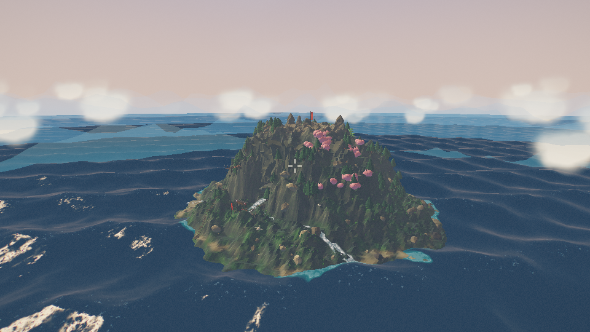
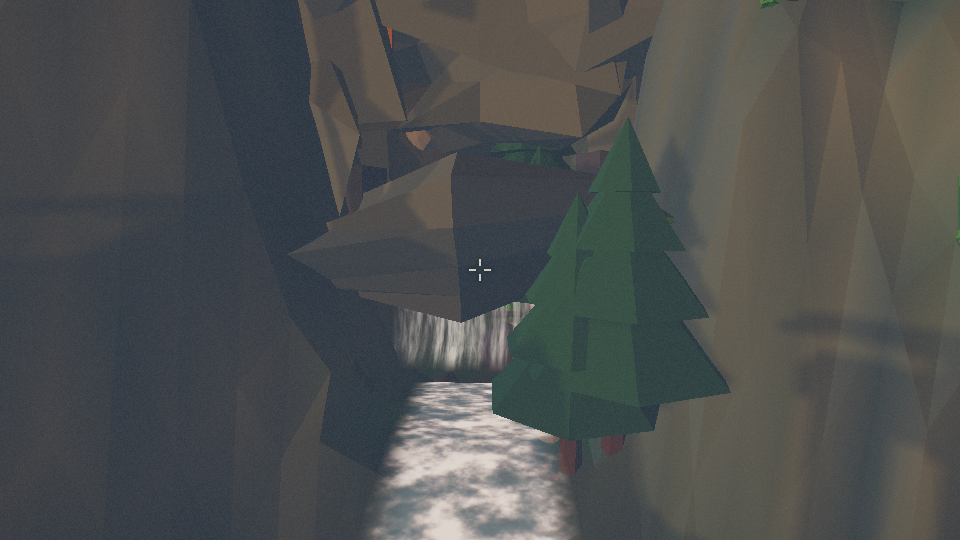
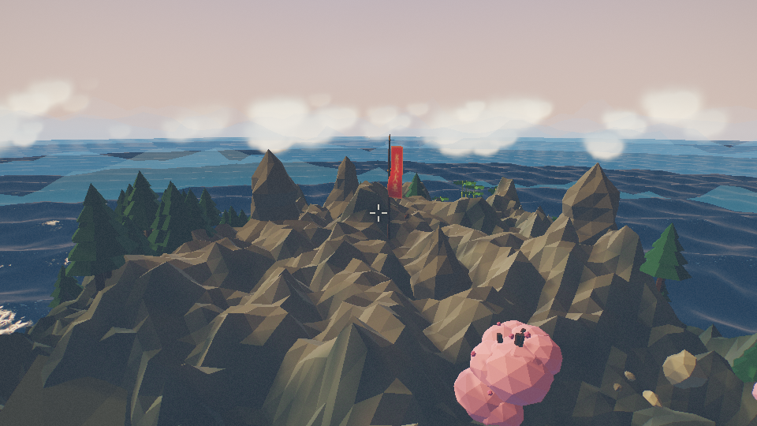
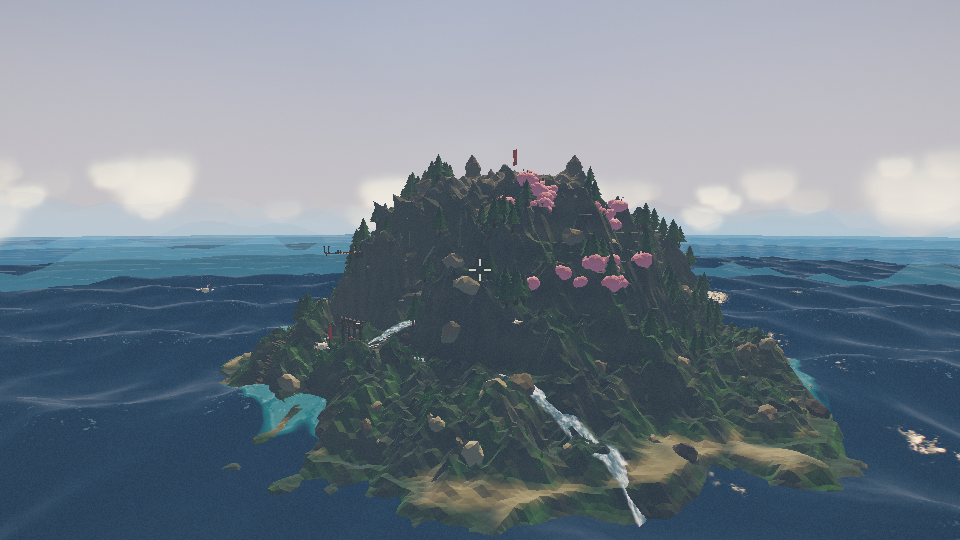
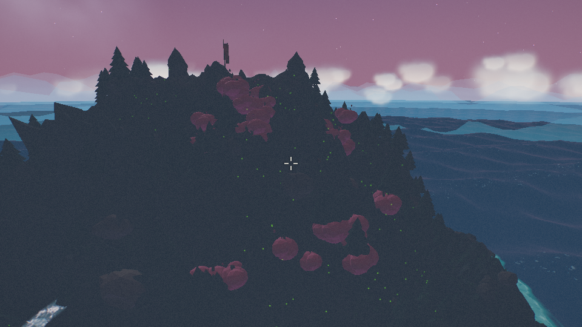
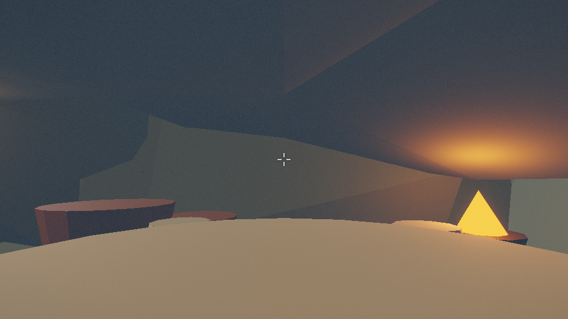

# 花果山 · 齐天大圣故里

《西游记》里那座山，我做成了一个能走进去的地方。

一个基于 Three.js 的实时 3D 场景：青绿山水配低多边形的造型，整座岛在浏览器里当场算出来——地形、岩石、海水、云海、草木、猴群，没有一个外部模型文件，也没有一张贴图，断网照样跑。



**[在线体验 →](https://mizzlelover.github.io/huaguoshan/)**

加载完点一下画面锁住鼠标，用 `WASD` 走几步。铁板桥会晃，旗子在飘，海是叠加的涌浪，天光是自己算出来的。

<table>
<tr>
<td></td>
<td></td>
<td></td>
</tr>
<tr>
<td align="center">水帘洞 · 铁板桥</td>
<td align="center">齐天大圣旗 · 山顶</td>
<td align="center">黄昏</td>
</tr>
<tr>
<td></td>
<td></td>
<td></td>
</tr>
<tr>
<td align="center">夜晚 · 蟠桃林萤火</td>
<td align="center">洞内陈设</td>
<td></td>
</tr>
</table>

## 运行

Three.js 以 ES Module 引入，必须经 HTTP 打开（`file://` 下浏览器不允许加载模块）：

```bash
npm start        # 即 python3 -m http.server 8123
```

然后打开 <http://localhost:8123>。

没有构建步骤，也没有需要安装的依赖：Three.js r169 已经放在 `vendor/three.module.min.js`，整个项目就是一个静态目录，扔进任何静态托管都能跑。

## 操作

进入场景后点击画面锁定鼠标，`ESC` 释放。

| 按键 | 功能 |
| --- | --- |
| `W` `A` `S` `D` | 行走 / 前后左右 |
| 鼠标 | 转视角 |
| `Shift` | 疾行 / 加速飞行 |
| `Space` | 跳跃 / 飞行上升 |
| `Ctrl` | 蹲行（降速至 42%、视高降 0.62 m）/ 飞行下降 |
| `F` | 切换自由飞行 |
| `Q` | 切换穿墙（无碰撞） |
| `C` | 第三人称环绕（`W`/`S` 推拉镜头） |
| `1`–`6` | 传送景点 |
| `N` | 昼夜循环开关 |
| `T` | 自动巡游 |
| `H` | 显示 / 隐藏操作面板 |
| `R` | 回到山门 |
| `P` | 截图下载 |

HUD 里有罗盘条、小地图、模式标签，以及坐标 / 高度 / 时刻读数。

## 山里有什么

| 区域 | 内容 |
| --- | --- |
| 山门 `SITE.gate` | 三间四柱牌坊、「花果山」匾额、石狮、蟠桃果篮、石阶 |
| 水帘洞 | 洞体、桶形拱顶、洞门石拱、石桌石凳、火盆、灯笼 |
| 峡谷 `SITE.bridge` | 铁板桥（铁桁架 + 铁链栏杆 + 桥台 + 石阶引道） |
| 蟠桃林 `SITE.peach` | 86 株桃树（花团 + 果实）、松林 |
| 竹海 `SITE.bamboo` | 240 竿竹 |
| 芭蕉 `SITE.bamboo` 西南 | 34 丛芭蕉 |
| 全岛 | 松林 252 株、草丛 620 丛、210 片体积云 |
| 生物 | 猴群 14 只、仙鹤 5 只（飞行时后掠收腿） |
| 夜间 | 420 点萤火虫（仅夜晚显现） |

植被共 2023 个实例、约 26 万顶点；全场景约 30.5 万三角形，同类植被各由一个 `InstancedMesh` 承载。

## 怎么造出来的

### 地形是全岛唯一的事实来源

`terrain.js` 用五层八度噪声叠上山脊算子烘出高度场，并导出 `WORLD`、`RAVINE`、`GORGE_Z` 和 `SITE`。水帘洞、瀑布、铁板桥、山门、蟠桃林的坐标全部以 `SITE` 为准——地形一改，山上的东西跟着挪，不会各说各话。

### 洞穴用实体几何，不用高度场

高度场表达不了顶棚和隧道。水帘洞是 `grotto.js` 拿岩石板块和桶形拱顶拼出来的，只有洞口朝着玩家，内部完全封闭，走进去是真的黑。

### 海面

四组 Gerstner 波叠加出涌浪，颜色按水深分层，岸线自动生泡沫。菲涅尔反射只吃滤掉高频细节的「宏观法线」，细节法线留给太阳高光和 sparkle——否则整片海会滑向大理石质感。

### 天空是自己写的

Rayleigh + Mie 单次散射，配一套按时刻插值的调色板：日出、正午、黄昏、月夜。按 `N` 切昼夜循环时，天光、雾色、水色、云色是一起走的，不会各变各的。

### 云海按半径淡入

云海是一片跟随相机的巨型平面，着色器里按 `length(vXZ)` 做 `smoothstep` 淡出，俯视时再把厚度压一层，于是它只出现在岛外的远海，不会糊在山上切出白斑。

### 一草一木都是实例

252 株松、86 株桃、240 竿竹、620 丛草，全部走 `InstancedMesh`，整座森林只用 8 个 draw call。猴群会巡逻、起伏，尾巴跟着摆；仙鹤飞行时腿是后掠收起的。

### 颜色只转换一次

颜色在创建时从 sRGB 转到线性空间，`stage.js` 用 `NoToneMapping` 加手写 ACES 近似，最后再转回 sRGB。整条链路只做一次色彩空间转换，既不重复叠加，也不过曝。

## 源码

```
index.html                入口：importmap、HUD、操作面板
styles/ui.css             界面样式
vendor/three.module.min.js  Three.js r169（本地化，无网络依赖）
src/
  main.js                 世界组装与渲染循环
  core/
    noise.js              Simplex / fbm / ridged 噪声与数学工具
    palette.js            PIGMENT 色板、SKY_KEYS 昼夜关键帧
    stage.js              渲染器、HDR、Bloom、ACES 合成、颗粒与暗角
    player.js             玩家控制器与 HUD 驱动
  world/
    terrain.js            花果山高度场、峡谷、梯田、顶点色、遮罩贴图
    ocean.js              Gerstner 海浪、深度色、岸线泡沫、菲涅尔
    sky.js                天空穹顶、日月、星空、雾、五层远山
    clouds.js             云海与实例化云团
    cloudtex.js           共享程序化云雾纹理
    rocks.js              石柱、巨石、岸石、瀑布口岩石
    water.js              瀑布、瀑唇、水潭、溪流、峡谷河、水雾
    grotto.js             水帘洞洞体、洞门石拱、匾额与洞内陈设
    flora.js              蟠桃林、松林、竹海、芭蕉与草丛
    props.js              山门牌坊、铁板桥、石碑、齐天大圣旗、石阶、石狮
    life.js               猴群、仙鹤、夜间萤火虫
    kit.js                共享材质、Canvas 标签与旗幡纹理、几何合并工具
```

`src/` 共约 5000 行 JavaScript，无第三方依赖（Three.js 之外）。

## 已知局限

- 洞内只靠灯笼和火盆照明，整体偏暗。
- 远景海面在极低 LOD 下能看出较大的平直三角面。
- 夜景地形接近纯黑，只剩剪影。

## 许可

[MIT](LICENSE)。拿来改、拿来用、拿来商用都行，保留版权声明即可。
